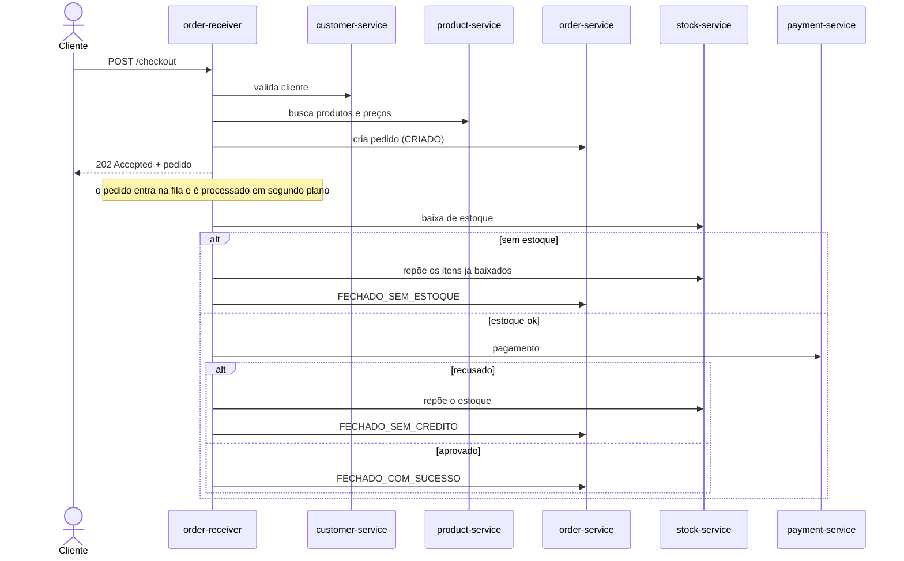

# orderflow


Sistema de gerenciamento de pedidos com microsserviços.

O cliente faz um checkout, o pedido é registrado e processado em segundo plano: o estoque é reservado, o pagamento é cobrado e, se algo falhar, as etapas anteriores são desfeitas (compensação).

## Tecnologias

- Java 17 e Spring Boot 3.5
- RabbitMQ (fila durável de pedidos)
- Spring Cloud OpenFeign (chamadas REST entre serviços)
- PostgreSQL 16 e Flyway (migrações)
- Bean Validation e Lombok
- Docker e Docker Compose
- Maven

## Arquitetura

| Serviço | Porta | Responsabilidade | Banco |
|---|---|---|---|
| `customer-service` | 8081 | Cadastro de clientes (CPF único) | `clientes` |
| `product-service` | 8082 | Cadastro de produtos (SKU único e preço) | `produtos` |
| `stock-service` | 8083 | Controle de estoque, com baixa e reposição | `estoque` |
| `order-service` | 8084 | Pedidos, itens e status | `pedidos` |
| `order-receiver-service` | 8085 | Recebe o checkout e orquestra o processamento | - |
| `payment-service` | 8086 | Pagamento simulado (mock) | - |

O checkout publica o pedido numa fila do RabbitMQ (`pedidos.processar`) e um consumidor o processa em segundo plano; o painel do broker fica em `http://localhost:15672` (guest/guest).

Todos os bancos ficam em uma única instância do PostgreSQL, criados pelo `init-db.sql`.

## Fluxo do pedido



### Status do pedido

| Status | Quando acontece |
|---|---|
| `CRIADO` | Pedido registrado e aguardando processamento |
| `FECHADO_COM_SUCESSO` | Estoque reservado e pagamento aprovado |
| `FECHADO_SEM_ESTOQUE` | Algum item não tinha estoque suficiente; o que já tinha sido baixado é devolvido |
| `FECHADO_SEM_CREDITO` | Pagamento recusado; o estoque é devolvido |

### Pagamento simulado

O `payment-service` não integra com nenhum gateway real:

- cartão que começa com `0000` é sempre recusado;
- qualquer outro cartão é aprovado em cerca de 80% das tentativas (sorteio).

## Como rodar

Pré-requisitos: Docker e Docker Compose.

```bash
git clone https://github.com/carolinenolasco/orderflow.git
cd orderflow
docker compose up --build -d
```

Na primeira vez, o build demora alguns minutos porque cada serviço baixa as dependências do Maven. Depois de uns 40 segundos, confira se os 7 containers estão no ar:

```bash
docker compose ps
```

Para parar tudo e apagar os dados:

```bash
docker compose down -v
```

## Exemplo de uso

Crie um cliente, um produto e o estoque:

```bash
curl -X POST localhost:8081/clientes -H 'Content-Type: application/json' \
  -d '{"nome":"Maria","cpf":"12345678901","dataNascimento":"1995-05-10","endereco":"Rua A, 10"}'

curl -X POST localhost:8082/produtos -H 'Content-Type: application/json' \
  -d '{"nome":"Mouse","sku":"MOUSE-1","preco":50.00}'

curl -X POST localhost:8083/estoques -H 'Content-Type: application/json' \
  -d '{"productId":1,"quantidade":5}'
```

Faça um checkout:

```bash
curl -X POST localhost:8085/checkout -H 'Content-Type: application/json' \
  -d '{"clienteId":1,"numeroCartao":"2222333344445555","itens":[{"produtoId":1,"quantidade":1}]}'
```

A resposta é imediata, com o pedido em `CRIADO`. Alguns segundos depois, consulte o resultado e o estoque:

```bash
curl localhost:8084/pedidos
curl localhost:8083/estoques/produto/1
```

### Testando os três desfechos

| Cenário | Como provocar | Resultado esperado |
|---|---|---|
| Sucesso | cartão `2222...`, quantidade 1 | `FECHADO_COM_SUCESSO`; estoque cai em 1 |
| Pagamento recusado | cartão `0000...`, quantidade 1 | `FECHADO_SEM_CREDITO`; estoque volta ao valor anterior |
| Sem estoque | cartão `2222...`, quantidade maior que o estoque | `FECHADO_SEM_ESTOQUE`; estoque não muda |

## Endpoints

| Serviço | Endpoints |
|---|---|
| customer | `POST /clientes`, `GET /clientes`, `GET /clientes/{id}`, `PUT /clientes/{id}`, `DELETE /clientes/{id}` |
| product | `POST /produtos`, `GET /produtos`, `GET /produtos/{id}`, `PUT /produtos/{id}`, `DELETE /produtos/{id}` |
| stock | `POST /estoques`, `GET /estoques`, `GET /estoques/{id}`, `GET /estoques/produto/{productId}`, `PUT /estoques/{id}`, `DELETE /estoques/{id}`, `PUT /estoques/produto/{productId}/baixa?quantidade=N`, `PUT /estoques/produto/{productId}/reposicao?quantidade=N` |
| order | `POST /pedidos`, `GET /pedidos`, `GET /pedidos/{id}`, `PUT /pedidos/{id}/status?status=...`, `DELETE /pedidos/{id}` |
| receiver | `POST /checkout` |
| payment | `POST /pagamentos` |

## Limitações conhecidas e próximos passos

- O `processar` não é idempotente como um todo: se o consumidor falhar depois de baixar o estoque e a mensagem for reprocessada, o estoque pode ser baixado duas vezes. O pagamento já é idempotente por `pedidoId`.
- O número do cartão trafega na mensagem da fila por simplificação; em produção, o correto é usar um token.
- Mensagens que falham 3 vezes são descartadas, sem fila de mensagens mortas (DLQ).
- O pagamento é um mock. A idempotência é por `pedidoId` e fica em memória: o mesmo pedido nunca é cobrado duas vezes, mas o registro se perde se o serviço reiniciar (o passo seguinte seria persistir em banco).
- Ainda não há autenticação.
- Faltam testes automatizados além do `contextLoads` e um pipeline de CI.
